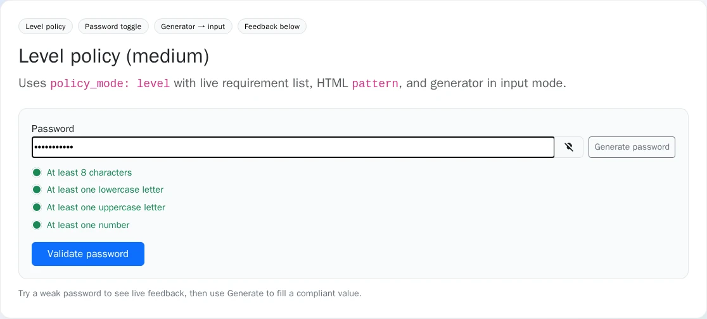
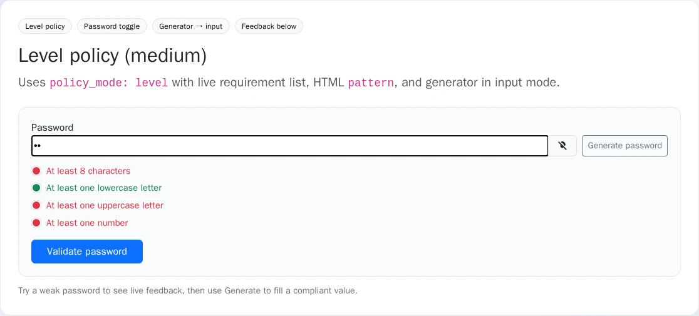

# Usage


## Table of contents

- [FrankenPHP worker mode](#frankenphp-worker-mode)
- [Basic form field](#basic-form-field)
- [Policy modes](#policy-modes)
  - [Level (preset)](#level-preset)
  - [Inline conditions](#inline-conditions)
- [Server-side enforcement (`enforce`)](#server-side-enforcement-enforce)
- [Validator constraint](#validator-constraint)
- [Generator](#generator)
- [Feedback position](#feedback-position)
- [HTML pattern](#html-pattern)
- [Overriding bundle templates (REQ-TWIG-001)](#overriding-bundle-templates-req-twig-001)
- [Translation overrides (REQ-I18N-001)](#translation-overrides-req-i18n-001)
- [Screenshots](#screenshots)
- [Demo routes](#demo-routes)
- [Related bundles](#related-bundles)

## Screenshots

Cropped to the form widget (not the demo chrome):

| Requirements met | Unmet feedback |
|------------------|----------------|
|  |  |

Regenerate with `make -C demo/symfony8 demo-screenshots` (REQ-DEMO-013).

## FrankenPHP worker mode

This bundle is compatible with FrankenPHP **worker** when the Symfony kernel is **reused** between requests (`FRANKENPHP_RESET_KERNEL` unset or `0` — the Runtime default). Shared services (`PolicyResolver`, `PasswordStrengthEvaluator`, `PasswordPatternBuilder`, `PasswordStrengthType`, `PasswordStrengthValidator`) hold only compiled configuration or are framework-managed per validation call. They do not need `kernel.reset`.

Full audit: [FRANKENPHP-WORKER-AUDIT.md](FRANKENPHP-WORKER-AUDIT.md). Demo runtime: [DEMO-FRANKENPHP.md](DEMO-FRANKENPHP.md).

## Basic form field

```php
use Nowo\PasswordStrengthBundle\Form\PasswordStrengthType;

$builder->add('password', PasswordStrengthType::class, [
    'policy_mode' => 'level',
    'level' => 'medium',
]);
```

The field value is a password string. The widget is the `<nowo-password-strength>` custom element (light DOM: native input + requirements list). Include `password-strength.js` after `assets:install`.

## Policy modes

### Level (preset)

```php
$builder->add('password', PasswordStrengthType::class, [
    'policy_mode' => 'level',
    'level' => 'strong', // a profile name: weak | medium | strong (built in) or one of your `profiles`
]);
```

`level` names a profile from `nowo_password_strength.profiles`; omitted or `null` uses `default_profile`, an unknown name throws an `InvalidOptionsException`. See [Profiles](CONFIGURATION.md#profiles).

### Inline conditions

```php
$builder->add('password', PasswordStrengthType::class, [
    'policy_mode' => 'conditions',
    'conditions' => [
        'min_length' => 10,
        'require_lowercase' => true,
        'require_uppercase' => true,
        'require_digit' => true,
        'require_special' => true,
        'not_contain' => ['password', '123456'],
    ],
]);
```

Inline `conditions` must use known keys (typos such as `min_lenght` throw) and hold at least one rule.

## Server-side enforcement (`enforce`)

By default (`enforce: true`) the field carries the `PasswordStrength` constraint built from its own `policy_mode` / `level` / `conditions`, so a submit that bypasses the browser checks is rejected server-side. Your own `constraints` are kept.

```php
use Symfony\Component\Validator\Constraints\NotBlank;
use Symfony\Component\Validator\Constraints\NotCompromisedPassword;

$builder->add('plainPassword', PasswordStrengthType::class, [
    'level' => 'strong',
    'mapped' => false,
    'constraints' => [new NotBlank(), new NotCompromisedPassword()], // PasswordStrength is added for you
]);
```

- **Entity constraint as well?** If the mapped property already has `#[PasswordStrength]`, set `'enforce' => false` (or drop the attribute): with both, every failure is reported twice.
- **Custom `validation_groups`:** the attached constraint is in the `Default` group. If the form validates other groups only, set `'enforce' => false` and add `new PasswordStrength(level: 'strong', groups: ['registration'])` to `constraints`.
- `PasswordStrength` accepts an empty value: add `NotBlank` when the password is required, and `NotCompromisedPassword` for account passwords.
- Values over **4096 bytes** are always rejected (`max_length`), before any rule runs.
- `trim` defaults to `false` (like Symfony's `PasswordType`): surrounding spaces are part of the password.
- The conditions are serialized into the widget for live feedback: do not put secrets in `not_contain` or `regex`.

## Validator constraint

Use on an entity or DTO (for example when the password does not go through `PasswordStrengthType`, or for API input). With the form type, `enforce` already attaches it — use one or the other:

```php
use Nowo\PasswordStrengthBundle\Validator\PasswordStrength;

#[PasswordStrength(
    policyMode: 'level',
    level: 'medium',
)]
private ?string $password = null;
```

Or with inline conditions:

```php
#[PasswordStrength(
    policyMode: 'conditions',
    conditions: ['min_length' => 8, 'require_digit' => true],
)]
private ?string $password = null;
```

## Generator

```php
$builder->add('password', PasswordStrengthType::class, [
    'generator_mode' => 'modal', // off | input | modal
    'generator_count' => 5,
]);
```

## Feedback position

```php
$builder->add('password', PasswordStrengthType::class, [
    'feedback_position' => 'above',
]);
```

## HTML pattern

The widget sets `pattern` on the input from the active policy. Browsers may use it for native validation; **always rely on the `PasswordStrength` validator** for authoritative checks.

## Overriding bundle templates (REQ-TWIG-001)

Application overrides **always win** when placed under:

```
templates/bundles/NowoPasswordStrengthBundle/<subpath>
```

**Procedure**

1. Pick the `<subpath>` from the table below (same path as under `src/Resources/views/` in the package).
2. Create `templates/bundles/NowoPasswordStrengthBundle/<subpath>` in your app.
3. Clear cache in dev if needed: `php bin/console cache:clear`.

| Subpath | Purpose |
|---------|---------|
| `Form/password_strength_theme.html.twig` | Base div layout theme |
| `Form/password_strength_theme_table.html.twig` | Table layout theme |
| `Form/password_strength_theme_bootstrap3.html.twig` | Bootstrap 3 |
| `Form/password_strength_theme_bootstrap3_horizontal.html.twig` | Bootstrap 3 horizontal |
| `Form/password_strength_theme_bootstrap4.html.twig` | Bootstrap 4 |
| `Form/password_strength_theme_bootstrap4_horizontal.html.twig` | Bootstrap 4 horizontal |
| `Form/password_strength_theme_bootstrap5.html.twig` | Bootstrap 5 |
| `Form/password_strength_theme_bootstrap5_horizontal.html.twig` | Bootstrap 5 horizontal |
| `Form/password_strength_theme_tailwind2.html.twig` | Tailwind 2 |
| `Form/password_strength_theme_foundation5.html.twig` | Foundation 5 |
| `Form/password_strength_theme_foundation6.html.twig` | Foundation 6 |

Twig namespace: `@NowoPasswordStrengthBundle/Form/...` (registered via `TwigPathsPass`).

The themes ship **only** the bundle's own blocks (`password_strength_widget`, `password_strength_feedback`, `password_strength_generate_button_class`) and never `extends` a Symfony layout, so they cannot shadow your `form_row` / `form_label` / `form_errors` blocks wherever they sit in `twig.form_themes`. You can also pull them into your own form theme:

```twig
{# templates/form/app_theme.html.twig #}


...
```

If you override a theme file, keep it free of `` for the same reason.

## Translation overrides (REQ-I18N-001)

Domain: **`NowoPasswordStrengthBundle`** (same as `translation_domain` on the form type).

The `PasswordStrength` constraint message (`password_strength.invalid`) lives in Symfony's **`validators`** domain (`src/Resources/translations/validators.<locale>.yaml`), because the validator component translates every violation message in that domain. Override it in your application's `translations/validators.<locale>.yaml`. Both domains ship the same locales (en, es, fr, de, it, pt, nl) and `make validate-translations` checks that every locale has the same keys as `en`.

**Procedure**

1. Create `translations/NowoPasswordStrengthBundle.<locale>.yaml` in your application.
2. Override only the keys you need; missing keys fall back to the bundle.

Example `translations/NowoPasswordStrengthBundle.es.yaml`:

```yaml
requirement:
  min_length: 'Al menos %count% caracteres'
  lowercase: 'Al menos una letra minúscula'
generator:
  button: 'Generar contraseña'
```

See bundle defaults in `src/Resources/translations/NowoPasswordStrengthBundle.en.yaml`.

## Demo routes

See [DEMO-FRANKENPHP.md](DEMO-FRANKENPHP.md). Examples:

- `/en/demo/level` — level presets
- `/en/demo/conditions` — inline conditions
- `/en/demo/plain` — Symfony `PasswordType` comparison

## Related bundles

- [PasswordToggleBundle](https://github.com/nowo-tech/PasswordToggleBundle) — optional show/hide toggle
